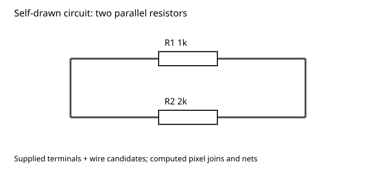
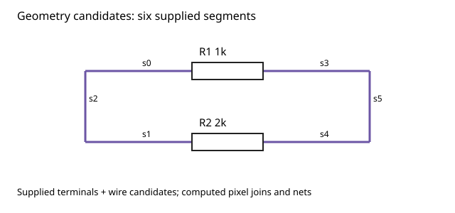
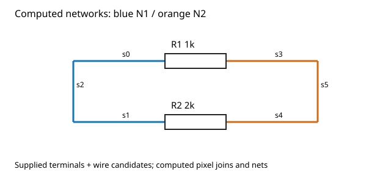

# PCB Schematic Parser — CV

将PCB原理图图片中的元件、引脚和导线转换为结构化网络数据。本项目展示我围绕 **YOLO候选检测、OCR文字关联和像素几何验证** 完成的CV解析工作。

## 自制演示

以下为程序绘制的两电阻并联电路，不使用赛事图片、GT或模型权重。

| 原图 | 几何中间图 | 网络结果 |
|---|---|---|
|  |  |  |

运行结果：[result.json](examples/geometry_demo/output/result.json)。蓝色网络连接R1.1和R2.1，橙色网络连接R1.2和R2.2。

**演示范围：** 元件、端点和候选线段由自绘场景提供；程序生成导线像素掩码，调用真实项目几何模块验证局部连接，再进行网络分组。没有执行YOLO检测或OCR，JSON是演示格式，不是赛事提交格式。它验证模块行为，不代表完整流水线准确率。

```bash
# Python 3.12；仅标准库，无需安装第三方依赖
python -I examples/geometry_demo/run_demo.py
```

命令重新生成三张SVG与JSON，并检查两个预期网络、空白间隙拒接和拐角连接。

## 我的工作

| 问题 | 我的处理方法 | 验证方式 |
|---|---|---|
| 元件图形、位号、数值和引脚文字混杂，单独检测框不能形成完整对象 | 搭建检测候选与OCR文字的关联流程，结合位置、器件类别和局部几何生成结构化元件及引脚 | 检查候选可视化和导出JSON，并在公开用例上做迭代回归；不将开发集成绩当作泛化结论 |
| 距离很近的导线容易被误接，短引脚和拐角又容易漏接 | 在几何候选之间检查已有像素的连通性，结合器件掩码和引脚方向构建网络 | 通过局部原图复核与回归结果分析错误；本仓库提供接触/间隙正负例，便于直接运行和解释 |
| 多阶段解析结果需要稳定导出并适配评测接口 | 整合命令行入口、结构化输出、运行记录及版本归档，区分本地诊断与平台反馈 | 保留历史平台结果口径；核心模块本次可读性重构通过2,000组固定随机差分检查，完整独立部署仍未验收 |

可从 [wire_join_continuity.py](code/wire_join_continuity.py) 开始阅读：选择局部候选接点 → 收集导线像素 → 八邻域搜索 → 返回是否连通。该模块不填补缺线，也不单独决定交叉线的电气语义。

## 处理流程

1. YOLO生成元件候选，OCR读取位号、数值及型号。
2. 结合类别、位置和局部几何关联文字、定位引脚。
3. 隔离器件实体，提取导线候选，依据接点像素构建连接组。
4. 导出元件、引脚、网络及线段JSON。

## 验证结果

| 对象 | 结果 | 适用范围 |
|---|---|---|
| CV201 | 平台公开13例：87.541932分 | 历史公开开发用例成绩，不代表隐藏集表现 |
| CV209（本仓库来源） | 本地新GT诊断约87.75分 | 本地估算，尚无已核实的该版本平台成绩 |
| 自制几何演示 | 两网络、空白间隙拒接、拐角连接检查通过 | 自制受控样例，不是检测精度或跨风格评估 |
| 几何模块可读性重构 | 2,000组固定随机差分检查一致 | 检查与原实现的行为一致性，不证明原算法总是正确 |

## 运行边界与局限

- **完整流水线与最小演示不同：** 最小演示仅用标准库；完整解析依赖未发布的权重、元件库及兼容环境，不能克隆后直接完成识别。详见 [外部资产说明](docs/ASSETS.md)。
- 不发布模型权重、训练数据、GT、赛事镜像、第三方wheel、密钥或平台日志。`requirements-extra.txt`是原基础环境上的附加依赖，不是独立完整环境。
- 嘉立创相关开发验证较充分；既有3张KiCad开发图表现较差，缺少独立AD准确率验证。缩放、压缩测试不等于跨风格验证。
- 像素连通不等于电气连通。文字干扰、交叉点语义、端点定位及掩码质量仍需上游规则处理；最小演示未覆盖这些复杂情况。

## 下载与许可

使用GitHub的Code → Download ZIP，或运行：

```bash
git clone https://github.com/26toki/pcb-schematic-parser-cv.git
```

当前是公开源码归档，尚未指定开源许可证，不额外授予使用或再分发许可。第三方依赖遵循各自许可证。完整流水线尚未完成脱离赛事环境的独立安装验证。
